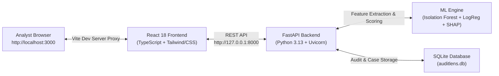

# AuditLens — Complete Local Setup Guide

This guide walks you through setting up and running **AuditLens** (Financial Anomaly & Fraud Investigation Copilot) locally from scratch, including the FastAPI backend, the React 18 TypeScript frontend, and the Machine Learning explainability engine.

---

## Architecture Overview

AuditLens consists of two interconnected local services:



---

## 1. Prerequisites

Ensure your development machine has the following tools installed:

| Requirement | Minimum / Recommended Version | Verification Command |
|---|---|---|
| **Python** | Python `3.11+` (tested on `3.13.7`) | `python3 --version` |
| **Node.js** | Node `v20.x+` (tested on `v25.6.1`) | `node -v` |
| **npm** | npm `10.x+` (tested on `11.9.0`) | `npm -v` |
| **SQLite** | SQLite `3.35+` | `sqlite3 --version` |
| **Git** | Git `2.30+` | `git --version` |

> [!NOTE]
> AuditLens runs cross-platform on **macOS** (Apple Silicon M1/M2/M3/M4 & Intel), **Linux** (Ubuntu/Debian/Fedora), and **Windows** (via WSL2 or PowerShell).

---

## 2. Repository Structure

A clean workspace layout after cloning:

```text
Machine learning project/
├── .env.example               # Root backend/system environment template
├── pytest.ini                 # Pytest configuration (pythonpath = .)
├── backend/                   # FastAPI backend service
│   ├── app/
│   │   ├── api/v1/            # API endpoints (health, upload, etc.)
│   │   ├── core/              # Config, errors, PII-masking logger
│   │   └── main.py            # FastAPI entrypoint & middleware
│   └── requirements.txt       # Python dependencies
├── frontend/                  # React 18 TypeScript frontend
│   ├── .env.example           # Frontend environment template
│   ├── package.json           # Node dependencies & npm scripts
│   ├── vite.config.ts         # Vite server with /api proxy to backend
│   └── src/                   # React components & dashboard
├── ml/                        # Machine Learning engine
│   ├── data/                  # Schema validation, loaders, profilers
│   ├── preprocessing/         # Robust scaling & cyclic time transforms
│   ├── models/                # Anomaly detectors, classifiers, trainer
│   ├── evaluation/            # PR-AUC, ROC-AUC, threshold optimizer
│   └── explainability/        # SHAP explainers & fallback attributions
├── data/
│   └── sample/                # Synthetic test fixtures & benchmark data
├── models/                    # Saved joblib pipelines and metadata JSON
└── tests/                     # Automated unit and integration test suite
```

---

## 3. Step-by-Step Setup Instructions

### Step 3.1: Clone the Repository & Configure Environment Variables

1. Open your terminal in the project directory:
   ```bash
   cd "/Users/dipakkumar/project/Machine learing project"
   ```

2. Create the backend environment file from template:
   ```bash
   cp .env.example .env
   ```
   *The default values in `.env` are configured for local development (`http://127.0.0.1:8000`, `auditlens.db`, etc.). No API keys are required for core features.*

3. Create the frontend environment file:
   ```bash
   cp frontend/.env.example frontend/.env
   ```

---

### Step 3.2: Set Up Python Virtual Environment & Install Backend Dependencies

1. Create a dedicated Python virtual environment:
   ```bash
   python3 -m venv .venv
   ```

2. Activate the virtual environment:
   - **macOS / Linux**:
     ```bash
     source .venv/bin/activate
     ```
   - **Windows (PowerShell)**:
     ```powershell
     .\.venv\Scripts\Activate.ps1
     ```
   - **Windows (Command Prompt)**:
     ```cmd
     .\.venv\Scripts\activate.bat
     ```

3. Upgrade `pip` and install all required backend and ML packages:
   ```bash
   pip install --upgrade pip
   pip install -r backend/requirements.txt
   pip install ruff  # Fast code linter & formatter
   ```

---

### Step 3.3: Set Up Frontend Dependencies

1. Navigate to the `frontend/` directory:
   ```bash
   cd frontend
   ```

2. Install all Node.js dependencies:
   ```bash
   npm install
   ```

3. Return to the project root:
   ```bash
   cd ..
   ```

---

### Step 3.4: Train Baseline Machine Learning Models

Generate the preprocessing pipelines and baseline models (Isolation Forest + Logistic Regression) from the local synthetic dataset:

```bash
# Make sure your virtual environment is active
python3 -m ml.models.trainer
```

**Expected output:**
```text
[*] Training baseline models from data/sample/synthetic_creditcard_sample.csv...
[+] Baseline models successfully saved to models/
[+] Baseline metrics: {'pr_auc': 1.0, 'roc_auc': 1.0, 'precision_at_0_5': 1.0, 'recall_at_0_5': 1.0, 'f1_at_0_5': 1.0}
```

This populates the `models/` directory with:
- `models/preprocessor.joblib` (Feature transformer & RobustScaler)
- `models/isolation_forest.joblib` (Unsupervised anomaly detector)
- `models/isolation_forest.json` (Hyperparameters & feature schema)
- `models/logistic_regression.joblib` (Supervised fraud classifier)
- `models/logistic_regression.json` (Hyperparameters & feature schema)
- `models/baseline_evaluation.json` (Consolidated metrics report)

---

## 4. Running the Application

To run the full stack, you need two terminal tabs open simultaneously.

### Terminal 1: Start the FastAPI Backend Server

```bash
# From project root:
source .venv/bin/activate
uvicorn backend.app.main:app --host 127.0.0.1 --port 8000 --reload
```

**Expected terminal output:**
```text
INFO:     Will watch for changes in: ['backend/app']
INFO:     Uvicorn running on http://127.0.0.1:8000 (Press CTRL+C to quit)
INFO:     Started reloader process [...]
INFO:     Started server process [...]
INFO:     Waiting for application startup.
INFO:     Application startup complete.
```

### Terminal 2: Start the React Frontend Development Server

```bash
# From project root:
cd frontend
npm run dev
```

**Expected terminal output:**
```text
  VITE v5.4.10  ready in 180 ms

  ➜  Local:   http://localhost:3000/
  ➜  Network: use --host to expose
  ➜  press h + enter to show help
```

---

## 5. Verifying Your Setup

1. **Open the Analyst Dashboard**:
   Navigate to [http://localhost:3000](http://localhost:3000) in your web browser.
   
2. **Verify Backend Connection**:
   Check the top right header badge on the dashboard. It should display:
   > 🟢 **API Online (v0.1.0)**
   
   The "BACKEND STATUS" card will read **ONLINE** and "PHASE GATE" will show **Phase 1 FOUNDATION VERIFIED**.

3. **Check Interactive API Documentation (Swagger)**:
   Navigate to [http://127.0.0.1:8000/docs](http://127.0.0.1:8000/docs).
   You can inspect and test the interactive OpenAPI endpoints:
   - `GET /health`: System health and version status
   - `POST /api/v1/data/upload`: CSV dataset validation and profiling

4. **Raw Health Endpoint Test**:
   ```bash
   curl -s http://127.0.0.1:8000/health | python3 -m json.tool
   ```
   **Response:**
   ```json
   {
       "status": "healthy",
       "environment": "development",
       "api_version": "0.1.0",
       "timestamp": "2026-11-02T17:15:00.000000Z"
   }
   ```

---

## 6. Running Automated Tests & Code Quality Checks

To verify that all components, algorithms, and security filters are functioning properly:

### Full Backend & ML Test Suite (74 tests)
```bash
# Ensure .venv is active
.venv/bin/pytest -v
```
*Expected: 74 passed in ~2.6 seconds.*

### Code Style & Linting Checks
```bash
.venv/bin/ruff check backend ml tests
.venv/bin/ruff format --check backend ml tests
```
*Expected: All checks passed!*

### Frontend Tests, Type-Checking & Production Build
```bash
cd frontend
npm test          # Runs Node.js test runner suite (2 tests)
npm run lint      # Runs TypeScript compiler check (tsc --noEmit)
npm run build     # Generates optimized production distribution
cd ..
```
*Expected: 2 passed, 0 type errors, production bundle built cleanly in `frontend/dist/`.*

---

## 7. Common Troubleshooting & FAQs

### Q1: `ModuleNotFoundError: No module named 'backend'` or `ml`
**Cause**: Python is running without the project root in its module path.
**Fix**: Ensure `pytest.ini` is present at the project root and always run commands using `.venv/bin/python` or with the virtual environment activated (`source .venv/bin/activate`).

---

### Q2: Frontend shows "🔴 API Offline" in the top badge
**Cause**: The FastAPI backend is not running, or Vite cannot proxy to port `8000`.
**Fix**:
1. Confirm the backend is running in Terminal 1 by visiting `http://127.0.0.1:8000/health`.
2. Check `frontend/vite.config.ts` to ensure `target: 'http://127.0.0.1:8000'` is configured.
3. Check `backend/app/core/config.py` to ensure `BACKEND_CORS_ORIGINS` includes `http://localhost:3000`.

---

### Q3: `Port 8000` or `Port 3000` is already in use
**Cause**: A leftover process is holding the port.
**Fix**:
- **Find and kill process on port 8000 (macOS/Linux)**:
  ```bash
  lsof -ti :8000 | xargs kill -9
  ```
- **Find and kill process on port 3000 (macOS/Linux)**:
  ```bash
  lsof -ti :3000 | xargs kill -9
  ```
- Alternatively, launch on a different port:
  ```bash
  uvicorn backend.app.main:app --port 8001 --reload
  ```
  *(Update `frontend/vite.config.ts` proxy target accordingly).*

---

### Q4: Warning about `feature_perturbation` during SHAP tests
**Cause**: Newer versions of `shap` on Python 3.13 deprecate `feature_perturbation` when using `LinearExplainer`.
**Status**: Handled automatically. AuditLens includes a built-in deterministic mathematical fallback attribution engine in `ml/explainability/explainer.py` to ensure feature attributions remain reliable under any environment.

---

### Q5: How do I retrain the models with a custom CSV dataset?
Run:
```bash
python3 -m ml.models.trainer --data path/to/your_dataset.csv --output-dir models/
```
The dataset must include columns `Time`, `Amount`, `V1` through `V28`, and binary target `Class` (`0` for non-fraud, `1` for fraud).

