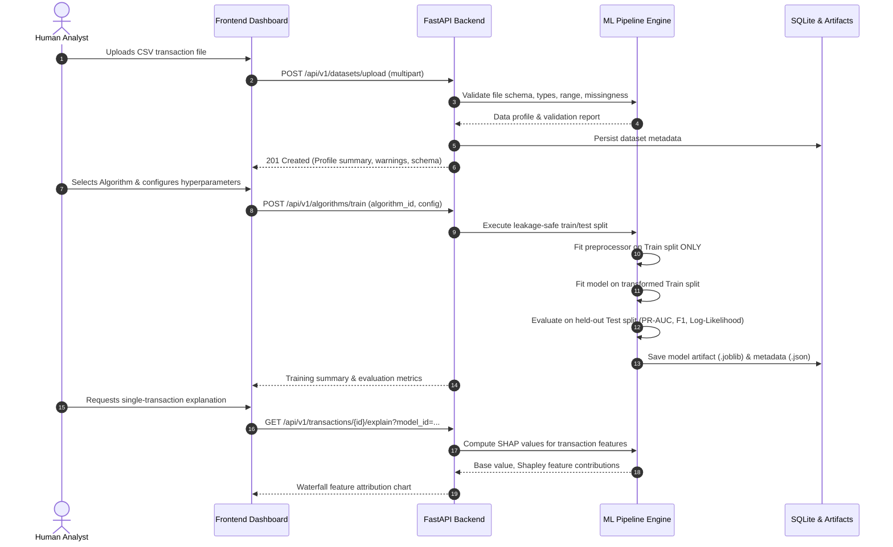
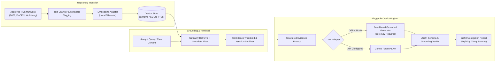

# AuditLens — System Architecture & Technical Blueprint

**Project Name:** AuditLens  
**Document:** System Architecture Specification  
**Version:** 1.0.0-dev  
**Date:** 2026-11-04  
**Status:** Approved for Implementation

---

## 1. Architectural Overview

AuditLens is designed as a modular, decoupled, two-tier client-server application optimized for local deployment, reproducible machine learning workflows, and transparent decision-support analytics.

```mermaid
flowchart TD
    subgraph Client ["Frontend: React 18 + TypeScript + Vite + Tailwind"]
        UI_Overview["Overview Dashboard"]
        UI_Data["Data Workspace (Upload & Quality)"]
        UI_Lab["Algorithm Lab (Units 3, 4, 5)"]
        UI_Explorer["Transaction Explorer & SHAP Detail"]
        UI_Cases["Case Management & Audit Trail"]
        UI_RAG["RAG Knowledge Base & Copilot Drafts"]
    end

    subgraph API_Layer ["API Layer: FastAPI (Python 3.13)"]
        Router_Health["/api/v1/health"]
        Router_Data["/api/v1/datasets"]
        Router_Algo["/api/v1/algorithms"]
        Router_Models["/api/v1/models"]
        Router_Tx["/api/v1/transactions"]
        Router_Cases["/api/v1/cases"]
        Router_RAG["/api/v1/rag"]
        Router_LLM["/api/v1/assistant"]
    end

    subgraph Service_Core ["Core Services & ML Pipeline Engine"]
        Svc_Data["Dataset & Validation Service"]
        Svc_Preproc["Leakage-Safe Preprocessor"]
        Svc_ML["ML Algorithm Engine (9 Syllabus Algorithms)"]
        Svc_Explain["SHAP & Feature Attribution"]
        Svc_Case["Case & Audit Service"]
        Svc_RAG["RAG Vector Ingestion & Retrieval"]
        Svc_LLM["Pluggable Assistant Engine"]
    end

    subgraph Storage_Layer ["Persistence & Local Storage"]
        DB_SQLite[("SQLite: auditlens.db\n(Metadata, Cases, Audits)")]
        Model_Artifacts[("Model Registry\n(artifacts/*.joblib, *.json)")]
        Data_Store[("Data Directory\n(data/raw, data/fixtures)")]
        Vector_Index[("Local Vector Store\n(Chroma / SQLite FTS5)")]
    end

    Client <-->|REST / JSON API| API_Layer
    API_Layer --> Service_Core
    Service_Core --> Storage_Layer
```



---

## 2. Technology Stack & Exact Versions

| Component | Technology | Version | Purpose |
|---|---|---|---|
| **Runtime Environment** | Python | 3.13.0 | Backend execution environment |
| **Backend Framework** | FastAPI | >=0.115.0 | High-performance asynchronous REST API framework |
| **Data Validation** | Pydantic | >=2.9.0 | Strict request/response schema validation and settings |
| **ASGI Server** | Uvicorn | >=0.32.0 | Production-grade ASGI web server |
| **ORM & Persistence** | SQLAlchemy | >=2.0.35 | Relational data mapping and query construction |
| **Database Migrations**| Alembic | >=1.13.0 | Versioned schema migration management |
| **Database Engine** | SQLite | 3.x (bundled) | Zero-configuration local transactional database |
| **Numerical Computing**| NumPy | >=2.1.0 | Vectorized array operations and analytical algorithms |
| **Data Manipulation** | Pandas | >=2.2.3 | Tabular data manipulation, EDA, and ingestion |
| **Machine Learning** | scikit-learn | >=1.5.2 | K-Means, GMM/EM, PCA, CART, metrics, pipelines |
| **Gradient Boosting** | XGBoost | >=2.1.2 | High-performance gradient boosted trees |
| **Model Explainability**| SHAP | >=0.46.0 | Shapley Additive exPlanations for tree models |
| **Backend Testing** | pytest + pytest-asyncio | >=8.3.0 | Unit and integration test execution |
| **Frontend Framework** | React | >=18.3.1 | Declarative component UI library |
| **Language & Typings** | TypeScript | >=5.6.0 | End-to-end type safety |
| **Build Tool & Bundler**| Vite | >=5.4.0 | Rapid development HMR and production bundling |
| **CSS Framework** | Tailwind CSS | >=3.4.0 | Utility-first styling with custom dark graphite theme |
| **Data Visualization** | Recharts | >=2.12.0 | Responsive chart rendering (PR, ROC, scatter, bar) |
| **Iconography** | Lucide React | >=0.450.0 | Clean, accessible SVG iconography |
| **HTTP Client** | Axios / Fetch API | Standard | Type-safe backend API communication |

---

## 3. Data Flow & Leakage-Safe Pipeline Architecture



---

## 4. Specification of the 9 Mandatory Syllabus Algorithms

### Unit 3 — Mixture Models and EM

#### 1. K-Means Clustering
- **Module:** `app/services/ml/kmeans.py`
- **Theoretical Role:** Partition unlabeled feature space into $k$ spherical clusters by iteratively minimizing within-cluster sum of squares (inertia):
  $$\arg\min_S \sum_{i=1}^k \sum_{x \in S_i} \|x - \mu_i\|^2$$
- **Implementation Strategy:** `sklearn.cluster.KMeans` with `init='k-means++'`, configurable $k$, and fixed `random_state`.
- **Outputs:** Cluster assignments ($c_i \in \{0, \dots, k-1\}$), cluster centroid coordinates, per-cluster summary statistics in original feature units, inertia curve for elbow analysis, and Silhouette score.
- **Decision Support Boundary:** Cluster membership is strictly a peer-group behavioral grouping; it is never labeled as a fraud probability.

#### 2. Gaussian Mixture Model (GMM) fitted via Expectation-Maximization (EM)
- **Module:** `app/services/ml/gmm_em.py`
- **Theoretical Role:** Model the probability distribution of transaction features as a convex combination of $K$ multivariate Gaussian components:
  $$p(x) = \sum_{k=1}^K \pi_k \mathcal{N}(x \mid \mu_k, \Sigma_k)$$
  Parameters $\theta = \{\pi_k, \mu_k, \Sigma_k\}$ are estimated via iterative EM:
  - **E-step:** Calculate posterior responsibilities $\gamma_{ik} = \frac{\pi_k \mathcal{N}(x_i \mid \mu_k, \Sigma_k)}{\sum_j \pi_j \mathcal{N}(x_i \mid \mu_j, \Sigma_j)}$
  - **M-step:** Update component weights, means, and covariance matrices using computed responsibilities.
- **Implementation Strategy:** `sklearn.mixture.GaussianMixture` supporting configurable covariance types (`full`, `tied`, `diag`), converged log-likelihood tracking, and AIC/BIC model selection.
- **Outputs:** Per-sample log-likelihood $\log p(x_i)$, component responsibilities vector, and percentile-based unusualness ranking (e.g. bottom 1% log-likelihood).
- **Decision Support Boundary:** Low log-likelihood denotes statistical rarity under the fitted Gaussian mixture, not proof of illicit activity.

#### 3. Principal Component Analysis (PCA)
- **Module:** `app/services/ml/pca.py`
- **Theoretical Role:** Orthogonal linear transformation projecting data onto directions of maximal variance via eigendecomposition of the covariance matrix:
  $$\Sigma = V \Lambda V^T$$
- **Implementation Strategy:** `sklearn.decomposition.PCA` fitted strictly on reference/training data.
- **Outputs:** Component eigenvectors, per-component explained variance ratio, cumulative variance trajectory, and 2D/3D projection coordinates for visualization.
- **Decision Support Boundary:** PCA coordinates are exploratory transformations; they do not replace interpretable raw features during final case adjudication.

---

### Unit 4 — Hidden Markov Models

#### 4. Hidden Markov Model (HMM) Framework
- **Module:** `app/services/ml/hmm.py`
- **Theoretical Role:** Generative sequential probabilistic graphical model characterized by $\lambda = (A, B, \pi)$:
  - Latent behavioral states: $S = \{s_1, \dots, s_N\}$ (e.g., Normal, Elevated Activity, High-Risk Burst)
  - State transition probability matrix: $A = [a_{ij}]$, where $a_{ij} = P(q_{t+1} = s_j \mid q_t = s_i)$
  - Emission probability distribution: $B = [b_j(o_t)] = P(o_t \mid q_t = s_j)$
  - Initial state distribution: $\pi = [\pi_i]$, where $\pi_i = P(q_1 = s_i)$
- **Implementation Strategy:** Documented, vectorized Python/NumPy implementation with Gaussian and categorical emission support to ensure transparent auditability and cross-platform numerical stability on Python 3.13 without compilation hurdles.
- **Outputs:** State transition matrix $A$, emission parameters $B$, initial probabilities $\pi$, and sequence log-likelihood.

#### 5. Forward Algorithm
- **Module:** `app/services/ml/hmm_forward.py`
- **Theoretical Role:** Efficient dynamic programming procedure to compute the total observation sequence probability $P(O \mid \lambda)$:
  $$\alpha_t(i) = P(o_1, o_2, \dots, o_t, q_t = s_i \mid \lambda)$$
  - **Initialization:** $\alpha_1(i) = \pi_i b_i(o_1)$
  - **Induction:** $\alpha_{t+1}(j) = \left[ \sum_{i=1}^N \alpha_t(i) a_{ij} \right] b_j(o_{t+1})$
  - **Termination:** $P(O \mid \lambda) = \sum_{i=1}^N \alpha_T(i)$
- **Numerical Stability:** Implementation uses log-sum-exp arithmetic or scaling coefficients $c_t = \frac{1}{\sum_i \alpha_t(i)}$ to strictly avoid arithmetic underflow on extended sequences.
- **Validation:** Analytical validation against toy hand-calculated 3-step transition matrices.

#### 6. Viterbi Algorithm
- **Module:** `app/services/ml/hmm_viterbi.py`
- **Theoretical Role:** Dynamic programming algorithm to decode the single most probable sequence of hidden states $Q^* = (q_1^*, \dots, q_T^*)$:
  $$v_t(j) = \max_{q_1, \dots, q_{t-1}} P(q_1, \dots, q_{t-1}, q_t = s_j, o_1, \dots, o_t \mid \lambda)$$
  - **Initialization:** $v_1(i) = \pi_i b_i(o_1)$, $\psi_1(i) = 0$
  - **Recursion:** $v_t(j) = \max_{1 \le i \le N} [v_{t-1}(i) a_{ij}] \cdot b_j(o_t)$, with backpointer $\psi_t(j) = \arg\max_{1 \le i \le N} [v_{t-1}(i) a_{ij}]$
  - **Termination:** $P^* = \max_{1 \le i \le N} v_T(i)$, $q_T^* = \arg\max_{1 \le i \le N} v_T(i)$
  - **Backtracking:** $q_t^* = \psi_{t+1}(q_{t+1}^*)$
- **Implementation:** Formulated in log-space: $\log v_t(j) = \max_i [\log v_{t-1}(i) + \log a_{ij}] + \log b_j(o_t)$.
- **Outputs:** Inferred state sequence and path probability score.

---

### Unit 5 — Combining Models

#### 7. Classification and Regression Trees (CART)
- **Module:** `app/services/ml/cart.py`
- **Theoretical Role:** Supervised non-parametric decision tree partitioning feature space by recursively maximizing Gini impurity reduction:
  $$\Delta I_G = I_G(D) - \frac{|D_L|}{|D|} I_G(D_L) - \frac{|D_R|}{|D|} I_G(D_R), \quad I_G(p) = 1 - \sum_{k=1}^C p_k^2$$
- **Implementation Strategy:** `sklearn.tree.DecisionTreeClassifier` with controlled `max_depth`, `min_samples_split`, and `min_samples_leaf` to prevent severe overfitting on sparse fraud labels.
- **Outputs:** Class probabilities, feature importances, and extracted text/tree decision rules providing transparent decision baselines.

#### 8. Boosting — XGBoost
- **Module:** `app/services/ml/xgboost_model.py`
- **Theoretical Role:** Regularized gradient boosting framework minimizing objective function over additive trees:
  $$\mathcal{L}^{(t)} = \sum_{i=1}^n l(y_i, \hat{y}_i^{(t-1)} + f_t(x_i)) + \Omega(f_t), \quad \Omega(f) = \gamma T + \frac{1}{2}\lambda \sum_{j=1}^T w_j^2$$
- **Implementation Strategy:** `xgboost.XGBClassifier` with `scale_pos_weight` tuned to the empirical negative-to-positive class imbalance ratio, early stopping on validation split, and `eval_metric='aucpr'`.
- **Outputs:** Supervised fraud probabilities $P(\text{Fraud} \mid x)$, feature gain/weight rankings, and TreeSHAP value matrices.

#### 9. Ensemble Learning (Voting & Stacking)
- **Module:** `app/services/ml/ensemble.py`
- **Theoretical Role:** Aggregating diverse models to reduce variance (Bagging/Voting) or bias (Stacking):
  - **Soft Voting:** Weighted average of predicted posterior class probabilities:
    $$P_{\text{ens}}(y = 1 \mid x) = \sum_{m=1}^M w_m P_m(y = 1 \mid x), \quad \sum w_m = 1$$
  - **Stacking:** Metaclassifier (e.g. Logistic Regression) trained on strictly out-of-fold cross-validated predictions of base learners (CART, XGBoost) to eliminate data leakage.
- **Validation:** Compared head-to-head against individual constituent models on the identical held-out test split.

---

## 5. Strict Score Taxonomy and Output Semantics

To uphold academic integrity and guard against misleading analyst interpretations, AuditLens strictly enforces semantic separation across all API responses and dashboard displays:

| Score Field | Algorithm Source | Mathematical Domain | Interpretation | Permitted Terminology |
|---|---|---|---|---|
| `fraud_probability` | CART / XGBoost / Ensemble | $[0.0, 1.0]$ | Estimated posterior probability given supervised labels | Supervised Fraud Probability |
| `gmm_log_likelihood` | GMM via EM | $(-\infty, 0.0]$ | Likelihood of observation under fitted multivariate mixture | Statistical Density / Likelihood |
| `gmm_unusualness_pct` | GMM via EM | $[0.0, 100.0]$ | Percentile rank of sample rarity | Unsupervised Unusualness Percentile |
| `kmeans_cluster_id` | K-Means | $\{0, \dots, k-1\}$ | Nearest centroid partition index | Behavioral Cluster Profile |
| `hmm_sequence_log_prob`| HMM Forward Algorithm | $(-\infty, 0.0]$ | Joint likelihood of sequence under temporal state model | Sequence Transition Likelihood |
| `hmm_inferred_state` | HMM Viterbi Algorithm | $\{s_1, \dots, s_N\}$ | Most probable latent sequence state | Inferred Latent State |
| `pca_coordinates` | PCA | $\mathbb{R}^d$ ($d=2$ or $3$) | Coordinates projected onto principal eigenvectors | Projection Coordinates |
| `anomaly_score` | Isolation Forest (Optional)| $[-1.0, 1.0]$ | Unsupervised partition depth score | Tabular Isolation Score |

> **Critical Safety Constraint:** AuditLens never collapses these heterogeneous metrics into a monolithic "Global Risk Score" without formal calibration, empirical validation, and domain-grounded weight justification.

---

## 6. Storage & Database Schema Design

AuditLens uses SQLite (`backend/data/auditlens.db`) managed via Alembic migrations.

### Core Relational Entities:
1. `datasets`:
   - `id` (UUID), `filename`, `row_count`, `column_count`, `schema_json`, `quality_report_json`, `created_at`
2. `model_runs`:
   - `id` (UUID), `algorithm_id`, `version`, `hyperparameters_json`, `metrics_json`, `artifact_path`, `feature_names_json`, `created_at`
3. `transactions`:
   - `id` (UUID), `dataset_id`, `external_tx_id`, `timestamp`, `amount`, `features_json`, `ground_truth_label`
4. `predictions`:
   - `id` (UUID), `model_run_id`, `transaction_id`, `score_type`, `score_value`, `metadata_json`
5. `cases`:
   - `id` (UUID), `case_number`, `title`, `status` (`NEW`, `UNDER_REVIEW`, `ESCALATED`, `CLOSED_BENIGN`, `CLOSED_SUSPICIOUS`), `priority` (`LOW`, `MEDIUM`, `HIGH`), `assigned_analyst`, `summary`, `created_at`, `updated_at`
6. `case_transactions`:
   - `id` (UUID), `case_id`, `transaction_id`, `added_reason`
7. `case_notes`:
   - `id` (UUID), `case_id`, `author`, `content`, `created_at`
8. `audit_events`:
   - `id` (UUID), `entity_type`, `entity_id`, `action`, `actor`, `diff_json`, `created_at`
9. `rag_documents`:
   - `id` (UUID), `title`, `issuing_body`, `publication_date`, `source_url`, `chunk_count`, `checksum`, `created_at`

---

## 7. RAG Knowledge Base & Pluggable LLM Assistant Architecture



### Safety and Security Safeguards:
- **Zero-Key Guarantee:** The entire system functions seamlessly without an external API key. The offline adapter generates clean, template-grounded draft summaries using retrieved excerpts.
- **Untrusted Context Isolation:** Content retrieved from vector storage is explicitly wrapped in non-executable data delimiters. Prompt injection strings inside documents are neutralized.
- **Traceable Citations:** Every claim in an investigation draft must link to an ingested document ID, section, and page number.
- **Human Approval Requirement:** Drafts cannot trigger automated account freezes, SAR filings, or external notifications.

---

## 8. Directory Blueprint

```
AuditLens/
├── AUDITLENS_FULL_BUILD_PROMPT.md        # Downloaded primary specification
├── README.md                             # High-level overview & quickstart
├── SETUP.md                              # Comprehensive reproducible setup guide
├── .env.example                          # Environment variable template
├── .gitignore                            # Exclusion rules for git
│
├── docs/                                 # Architectural and project documentation
│   ├── ARCHITECTURE.md                   # This document
│   ├── PROJECT_PLAN.md                   # Detailed phased implementation roadmap
│   ├── DECISIONS.md                      # Architectural Decision Records (ADRs)
│   ├── PHASE_STATUS.md                   # Live phase status ledger
│   ├── DATASET_CARD.md                   # Dataset provenance & characteristics
│   ├── DATA_DICTIONARY.md                # Feature descriptions and semantic definitions
│   ├── ALGORITHM_GUIDE.md                # Mathematical formulations and analysis guide
│   ├── API.md                            # OpenAPI / REST endpoint specifications
│   ├── RAG_SOURCES.md                    # Permitted reference document registry
│   ├── SECURITY_AND_PRIVACY.md           # Security controls and privacy guidelines
│   ├── FINAL_REPORT.md                   # Academic project summary and conclusions
│   └── MODEL_CARDS/                      # Per-model performance & operational cards
│
├── backend/                              # Python FastAPI backend service
│   ├── pyproject.toml                    # Tooling configurations (Ruff, pytest)
│   ├── requirements.txt                  # Pinned core production dependencies
│   ├── requirements-dev.txt              # Linting, typing, and testing dependencies
│   ├── alembic.ini                       # Alembic database migration config
│   ├── alembic/                          # Migration revision scripts
│   │   ├── env.py
│   │   └── versions/
│   ├── app/
│   │   ├── __init__.py
│   │   ├── main.py                       # FastAPI application entrypoint
│   │   ├── core/                         # Global configuration, logging, errors
│   │   │   ├── config.py
│   │   │   ├── logging.py
│   │   │   └── errors.py
│   │   ├── db/                           # Database connection & base models
│   │   │   ├── session.py
│   │   │   └── base.py
│   │   ├── models/                       # SQLAlchemy ORM entities
│   │   │   ├── dataset.py
│   │   │   ├── model_run.py
│   │   │   ├── transaction.py
│   │   │   ├── case.py
│   │   │   └── audit.py
│   │   ├── schemas/                      # Pydantic schemas (Request/Response)
│   │   │   ├── common.py
│   │   │   ├── dataset.py
│   │   │   ├── algorithm.py
│   │   │   ├── transaction.py
│   │   │   ├── case.py
│   │   │   └── rag.py
│   │   ├── api/                          # REST route controllers
│   │   │   ├── v1/
│   │   │   │   ├── api.py
│   │   │   │   └── endpoints/
│   │   │   │       ├── health.py
│   │   │   │       ├── datasets.py
│   │   │   │       ├── algorithms.py
│   │   │   │       ├── models.py
│   │   │   │       ├── transactions.py
│   │   │   │       ├── cases.py
│   │   │   │       ├── rag.py
│   │   │   │       └── assistant.py
│   │   └── services/                     # Business logic and ML modules
│   │       ├── dataset_service.py
│   │       ├── case_service.py
│   │       ├── rag_service.py
│   │       ├── llm_service.py
│   │       └── ml/                       # The 9 Syllabus Algorithm Implementations
│   │           ├── preprocessing.py
│   │           ├── kmeans.py             # Unit 3: K-Means
│   │           ├── gmm_em.py             # Unit 3: GMM with EM
│   │           ├── pca.py                # Unit 3: PCA
│   │           ├── hmm.py                # Unit 4: HMM Framework
│   │           ├── hmm_forward.py        # Unit 4: Forward Algorithm
│   │           ├── hmm_viterbi.py        # Unit 4: Viterbi Algorithm
│   │           ├── cart.py               # Unit 5: CART Tree
│   │           ├── xgboost_model.py      # Unit 5: XGBoost Classifier
│   │           ├── ensemble.py           # Unit 5: Voting & Stacking Ensemble
│   │           ├── isolation_forest.py   # Supporting: Isolation Forest
│   │           └── explainability.py     # SHAP and feature attribution
│   └── tests/
│       ├── conftest.py
│       ├── unit/                         # Algorithmic and mathematical unit tests
│       │   ├── test_kmeans.py
│       │   ├── test_gmm.py
│       │   ├── test_pca.py
│       │   ├── test_hmm.py
│       │   ├── test_hmm_forward.py
│       │   ├── test_hmm_viterbi.py
│       │   ├── test_cart.py
│       │   ├── test_xgboost.py
│       │   └── test_ensemble.py
│       └── integration/                  # End-to-end API integration tests
│           ├── test_api_health.py
│           ├── test_datasets_api.py
│           └── test_cases_api.py
│
├── frontend/                             # React TypeScript SPA (Vite + Tailwind)
│   ├── package.json
│   ├── tsconfig.json
│   ├── tsconfig.node.json
│   ├── vite.config.ts
│   ├── tailwind.config.js
│   ├── postcss.config.js
│   ├── index.html
│   ├── src/
│   │   ├── main.tsx
│   │   ├── App.tsx
│   │   ├── index.css                     # Graphite theme styling
│   │   ├── types/                        # TypeScript API contract definitions
│   │   │   ├── index.ts
│   │   │   ├── dataset.ts
│   │   │   ├── algorithm.ts
│   │   │   ├── case.ts
│   │   │   └── rag.ts
│   │   ├── services/                     # Axios/Fetch API client
│   │   │   └── api.ts
│   │   └── components/                   # UI View Components
│   │       ├── common/                   # Shared UI primitives (Badges, Buttons, Modal)
│   │       ├── layout/                   # Navbar, Sidebar, Page Shell
│   │       ├── overview/                 # Operational Overview Dashboard
│   │       ├── data_workspace/           # CSV Upload, Profiling, Schema Validation
│   │       ├── algorithm_lab/            # Algorithmic parameter controls & execution
│   │       ├── model_comparison/         # PR/ROC curves, metrics, confusion matrices
│   │       ├── transaction_explorer/     # Transaction table, filtering, SHAP drawer
│   │       ├── case_management/          # Case list, notes, status workflow
│   │       └── rag_assistant/            # Document search & grounded draft generator
│   └── tests/
│       └── smoke.test.tsx
│
├── data/                                 # Data storage (segregated by role)
│   ├── raw/                              # Uploaded CSVs (strictly gitignored)
│   ├── processed/                        # Preprocessed splits & caches (gitignored)
│   ├── fixtures/                         # Small synthetic datasets for tests (tracked)
│   │   ├── creditcard_sample_fixture.csv
│   │   └── sequence_account_fixture.csv
│   └── reference_docs/                   # Permitted public AML/Fraud reference PDFs/MDs
│
└── artifacts/                            # Serialized models, scalers, and metadata (gitignored)
```

